<!-- Generated by scripts/build_readme.py from README.template.md. Edit the template, not README.md. -->

<!-- SLATE -->

  <picture><source media="(prefers-color-scheme: dark)" srcset="slate/dark/slate.svg"/></picture>

<!-- SHOTS: one card per pinned repository, in pin order -->

<a href="https://github.com/healkeiser?tab=repositories"><picture><source media="(prefers-color-scheme: dark)" srcset="slate/dark/shots-header.svg"/></picture></a>
<a href="https://github.com/healkeiser/fxhoudinimcp"><picture><source media="(prefers-color-scheme: dark)" srcset="slate/dark/shot-SH010.svg"/></picture></a>
<a href="https://github.com/healkeiser/HdUnrealEngine"><picture><source media="(prefers-color-scheme: dark)" srcset="slate/dark/shot-SH020.svg"/></picture></a>
<a href="https://github.com/healkeiser/fxgui"><picture><source media="(prefers-color-scheme: dark)" srcset="slate/dark/shot-SH030.svg"/></picture></a>
<a href="https://github.com/healkeiser/fxhoudinimotion"><picture><source media="(prefers-color-scheme: dark)" srcset="slate/dark/shot-SH040.svg"/></picture></a>
<a href="https://github.com/healkeiser/fxserver"><picture><source media="(prefers-color-scheme: dark)" srcset="slate/dark/shot-SH050.svg"/></picture></a>
<a href="https://github.com/healkeiser/youtrack-companion"><picture><source media="(prefers-color-scheme: dark)" srcset="slate/dark/shot-SH060.svg"/></picture></a>
<a href="https://github.com/healkeiser?tab=repositories"><picture><source media="(prefers-color-scheme: dark)" srcset="slate/dark/shots-footer.svg"/></picture></a>

<!-- DAILIES: newest real work across recently pushed public repositories -->

<a href="https://github.com/healkeiser?tab=repositories"><picture><source media="(prefers-color-scheme: dark)" srcset="slate/dark/dailies-header.svg"/></picture></a>
<a href="https://github.com/healkeiser/fxhoudinimcp/commit/2c4aa018d4331c48b46154a9ec3decc66f9dc374"><picture><source media="(prefers-color-scheme: dark)" srcset="slate/dark/daily-01.svg"/></picture></a>
<a href="https://github.com/healkeiser/fxhoudinimcp/commit/bcba4e2afcd21869e100f81ec968e198d985de8a"><picture><source media="(prefers-color-scheme: dark)" srcset="slate/dark/daily-02.svg"/></picture></a>
<a href="https://github.com/healkeiser/fxgui/commit/22e7ef50c0d39d5d6c806e4bcf02ffac7fc1edb4"><picture><source media="(prefers-color-scheme: dark)" srcset="slate/dark/daily-03.svg"/></picture></a>
<a href="https://github.com/healkeiser/fxgui/commit/2659478f057063f29d9145599c9d3764f07b8d88"><picture><source media="(prefers-color-scheme: dark)" srcset="slate/dark/daily-04.svg"/></picture></a>
<a href="https://github.com/healkeiser/claude-plugins/commit/b295836502f40a6dc386452c6441d728e0eff343"><picture><source media="(prefers-color-scheme: dark)" srcset="slate/dark/daily-05.svg"/></picture></a>
<a href="https://github.com/healkeiser?tab=repositories"><picture><source media="(prefers-color-scheme: dark)" srcset="slate/dark/dailies-footer.svg"/></picture></a>

<!-- CREDITS -->

  
    <a href="https://www.linkedin.com/in/valentin-beaumont">LinkedIn</a> ·
    <a href="https://www.behance.net/el1ven">Behance</a> ·
    <a href="https://www.instagram.com/val.beaumontart">Instagram</a> ·
    <a href="https://twitter.com/valentinbeaumon">X</a> ·
    <a href="https://healkeiser.gumroad.com/subscribe">Gumroad</a> ·
    <a href="https://github.com/sponsors/healkeiser">Sponsor</a>
  
   
  Rendered nightly by <a href="scripts/build_readme.py">a GitHub Action</a>.

