<!-- Generated by scripts/build_readme.py from README.template.md. Edit the template, not README.md. -->

<!-- SLATE -->

  

<!-- SHOTS: one card per pinned repository, in pin order -->
{{SHOTS}}

<!-- DAILIES: newest real work across recently pushed public repositories -->
{{DAILIES}}

<!-- CREDITS -->

  
    <a href="https://www.linkedin.com/in/valentin-beaumont">LinkedIn</a> ·
    <a href="https://www.behance.net/el1ven">Behance</a> ·
    <a href="https://www.instagram.com/val.beaumontart">Instagram</a> ·
    <a href="https://twitter.com/valentinbeaumon">X</a> ·
    <a href="https://healkeiser.gumroad.com/subscribe">Gumroad</a> ·
    <a href="https://github.com/sponsors/healkeiser">Sponsor</a>
  
   
  Rendered nightly by <a href="scripts/build_readme.py">a GitHub Action</a>.

